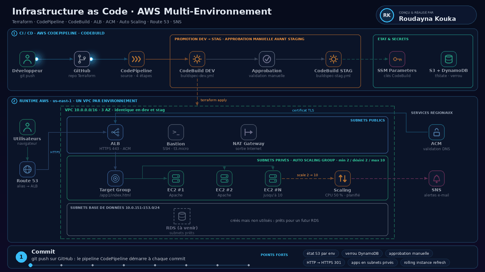

# Terraform IaC DevOps avec AWS CodePipeline


Infrastructure as Code (IaC) complète sur AWS, provisionnée avec **Terraform** et déployée automatiquement par un pipeline **AWS CodePipeline / CodeBuild** sur deux environnements isolés : **dev** et **staging**.

Chaque `git push` déclenche le pipeline : Terraform est exécuté sur l'environnement **dev**, puis, après une **approbation manuelle**, sur l'environnement **stag**. Chaque environnement a son propre VPC, son propre état Terraform (S3 + verrou DynamoDB) et son propre nom DNS.

---

## Sommaire

- [Architecture](#architecture)
- [Ressources provisionnées](#ressources-provisionnées)
- [Pipeline CI/CD](#pipeline-cicd)
- [Structure du projet](#structure-du-projet)
- [Prérequis](#prérequis)
- [Déploiement](#déploiement)
- [Variables et environnements](#variables-et-environnements)
- [Outputs](#outputs)
- [Tester l'application](#tester-lapplication)
- [Suppression de l'infrastructure](#suppression-de-linfrastructure)
- [Sécurité et pistes d'amélioration](#sécurité-et-pistes-damélioration)
- [Auteur](#auteur)

---

## Architecture



**Flux applicatif :**
`Utilisateur → Route 53 (devdemo5 / stagedemo5.devopsincloud.com) → ALB (HTTPS, certificat ACM) → Target Group → instances EC2 de l'Auto Scaling Group (subnets privés)`

**Flux de déploiement :**
`git push → CodePipeline → CodeBuild DEV (terraform apply dev) → Approbation manuelle → CodeBuild STAG (terraform apply stag)`

---

## Ressources provisionnées

| Composant | Fichier(s) | Détails |
|---|---|---|
| **VPC** | `c4-*` | Module `terraform-aws-modules/vpc` 3.0.0 — CIDR `10.0.0.0/16`, 3 AZ, subnets publics, privés et base de données, NAT Gateway unique, DNS activé |
| **Security Groups** | `c5-*` | Bastion (SSH 22), instances privées (22 / 80 / 8080 depuis le VPC), Load Balancer (80 / 443 / 81 depuis Internet) |
| **Data sources** | `c6-*` | AMI Amazon Linux 2 la plus récente, zone hébergée Route 53 `devopsincloud.com` |
| **Bastion Host** | `c7-*`, `c8-*` | EC2 `t3.micro` dans un subnet public + Elastic IP |
| **Provisioners** | `c9-*` | `null_resource` : copie de la clé `.pem` sur le bastion et `chmod 400` |
| **Application Load Balancer** | `c10-*` | Module `alb` 6.0.0 — HTTP :80 redirigé en 301 vers HTTPS :443, target group `app1`, health check `/app1/index.html` |
| **Certificat SSL** | `c11-*` | Module `acm` 3.0.0 — validation DNS via Route 53 |
| **DNS** | `c12-*` | Enregistrement `A` alias vers l'ALB, un nom par environnement |
| **Launch Template** | `c13-02` | Amazon Linux 2, `t3.micro`, EBS gp2 20 Go, monitoring détaillé, `user_data` = `app1-install.sh` (Apache httpd) |
| **Auto Scaling Group** | `c13-03` | Subnets privés, min 2 / désiré 2 / max 10, *instance refresh* en mode rolling (50 % sain minimum) |
| **Notifications** | `c13-05` | Topic SNS + abonnement e-mail sur les événements LAUNCH / TERMINATE (et erreurs) |
| **Scaling dynamique** | `c13-06` | Target tracking : CPU moyen à 50 %, 10 requêtes ALB par cible |
| **Scaling planifié** | `c13-07` | Montée à 8 instances à 09:00 UTC, retour à 2 à 21:00 UTC |

> Les subnets de base de données (`10.0.151-153.0/24`) et leur subnet group sont créés mais **aucune base n'est déployée** : ils sont prêts pour un futur RDS.

---

## Pipeline CI/CD

Le pipeline AWS CodePipeline comporte quatre étapes :

1. **Source** : connexion au dépôt GitHub, déclenchée à chaque commit.
2. **Build DEV** : projet CodeBuild utilisant `buildspec-dev.yml`.
3. **Approbation manuelle** : validation humaine avant la promotion.
4. **Build STAG** : projet CodeBuild utilisant `buildspec-stag.yml`.

Chaque buildspec :

```text
install     → télécharge Terraform 0.15.3
pre_build   → log de démarrage
build       → terraform init  -backend-config=<env>.conf
              terraform validate
              terraform plan  -var-file=<env>.tfvars
              terraform $TF_COMMAND -var-file=<env>.tfvars -auto-approve
post_build  → log de fin
```

- Les identifiants AWS sont lus depuis **SSM Parameter Store** (`/CodeBuild/MY_AWS_ACCESS_KEY_ID`, `/CodeBuild/MY_AWS_SECRET_ACCESS_KEY`).
- La variable `TF_COMMAND` vaut `apply` par défaut ; la passer à `destroy` dans le buildspec permet de supprimer l'environnement via le pipeline.

---

## Structure du projet

```text
terraform-iac-devops/
├── buildspec-dev.yml          # CodeBuild — environnement dev
├── buildspec-stag.yml         # CodeBuild — environnement staging
├── LICENSE
├── README.md
├── docs/
│   └── architecture.png       # Schéma d'architecture
└── terraform-manifests/
    ├── c1-versions.tf                     # Terraform, providers, backend S3, random_pet
    ├── c2-generic-variables.tf            # Région, environnement, division
    ├── c3-local-values.tf                 # Nom <division>-<env>, tags communs
    ├── c4-0x-vpc-*.tf                     # VPC (variables, module, outputs)
    ├── c5-0x-securitygroup-*.tf           # Security groups
    ├── c6-0x-datasource-*.tf              # AMI + zone Route 53
    ├── c7-0x-ec2instance-*.tf             # Bastion host
    ├── c8-elasticip.tf                    # EIP du bastion
    ├── c9-nullresource-provisioners.tf    # Provisioners file / remote-exec
    ├── c10-0x-ALB-*.tf                    # Application Load Balancer
    ├── c11-acm-certificatemanager.tf      # Certificat ACM
    ├── c12-route53-dnsregistration.tf     # Enregistrement DNS
    ├── c13-0x-autoscaling-*.tf            # Launch template, ASG, SNS, policies
    ├── app1-install.sh                    # user_data : installation d'Apache + app1
    ├── terraform.tfvars                   # Variables communes (région, division)
    ├── dev.tfvars / stag.tfvars           # Variables par environnement
    ├── dev.conf / stag.conf               # Configuration du backend S3 par env
    └── private-key/terraform-key.pem      # ⚠️ voir la section Sécurité
```

---

## Prérequis

- Un compte AWS avec les droits sur VPC, EC2, ELB, Auto Scaling, ACM, Route 53, SNS, S3, DynamoDB et SSM.
- Une **zone hébergée Route 53** publique (ici `devopsincloud.com`, à remplacer par votre domaine dans `c6-02-datasource-route53-zone.tf` et dans les `*.tfvars`).
- Une **paire de clés EC2** nommée `terraform-key` dans `us-east-1`.
- Un **bucket S3** pour l'état Terraform et **deux tables DynamoDB** (clé de partition `LockID`, type String) :
  - `iacdevops-dev-tfstate`
  - `iacdevops-stag-tfstate`
- Les deux paramètres SSM `SecureString` utilisés par CodeBuild.
- Pour une exécution locale : Terraform `~> 0.14` (testé en 0.15.3) et l'AWS CLI configurée (profil `default`).

---

## Déploiement

### Via le pipeline (recommandé)

1. Créer le bucket S3 et les tables DynamoDB, et mettre à jour `dev.conf` / `stag.conf`.
2. Créer les paramètres SSM :
   ```bash
   aws ssm put-parameter --name /CodeBuild/MY_AWS_ACCESS_KEY_ID     --type SecureString --value "<ACCESS_KEY>"
   aws ssm put-parameter --name /CodeBuild/MY_AWS_SECRET_ACCESS_KEY --type SecureString --value "<SECRET_KEY>"
   ```
3. Créer deux projets CodeBuild (image Amazon Linux 2 standard) pointant vers `buildspec-dev.yml` et `buildspec-stag.yml`, et autoriser leur rôle de service à lire les paramètres SSM (`ssm:GetParameters`).
4. Créer le pipeline CodePipeline : **Source GitHub → Build DEV → Manual approval → Build STAG**.
5. Pousser sur la branche suivie : le pipeline se lance.

### En local

```bash
cd terraform-manifests

# Environnement dev
terraform init -backend-config=dev.conf
terraform validate
terraform plan  -var-file=dev.tfvars
terraform apply -var-file=dev.tfvars

# Environnement staging (nouveau backend → reconfigure)
terraform init -reconfigure -backend-config=stag.conf
terraform apply -var-file=stag.tfvars
```

---

## Variables et environnements

| Variable | Défaut | dev | stag |
|---|---|---|---|
| `aws_region` | `us-east-1` | `us-east-1` | `us-east-1` |
| `business_divsion` | `sap` | `hr` (terraform.tfvars) | `hr` |
| `environment` | `dev` | `dev` | `stag` |
| `vpc_cidr_block` | `10.0.0.0/16` | `10.0.0.0/16` | `10.0.0.0/16` |
| `vpc_availability_zones` | 2 AZ | 3 AZ (a, b, c) | 3 AZ (a, b, c) |
| `instance_type` | `t3.micro` | `t3.micro` | `t3.micro` |
| `dns_name` | — | `devdemo5.devopsincloud.com` | `stagedemo5.devopsincloud.com` |
| Clé du state | — | `iacdevops/dev/terraform.tfstate` | `iacdevops/stag/terraform.tfstate` |

Les ressources sont nommées `<business_division>-<environment>` (ex. `hr-dev-alb`, `hr-stag-private-sg`) et taguées avec `owners` et `environment`.

---

## Outputs

Principaux outputs exposés après un `apply` :

- **Réseau** : `vpc_id`, `public_subnets`, `private_subnets`, `nat_public_ips`, `azs`
- **Bastion** : `ec2_bastion_public_ip`, `ec2_bastion_public_instance_ids`
- **Load balancer** : `lb_dns_name`, `lb_arn`, `lb_zone_id`, `target_group_arns`
- **Auto Scaling** : `autoscaling_group_name`, `launch_template_id`, `launch_template_latest_version`
- **DNS / TLS** : `mydomain_zoneid`, `this_acm_certificate_arn`

```bash
terraform output lb_dns_name
```

---

## Tester l'application

```bash
# Redirection HTTP → HTTPS
curl -I http://devdemo5.devopsincloud.com

# Page de l'application
curl https://devdemo5.devopsincloud.com/app1/index.html

# Métadonnées de l'instance qui a répondu (permet de voir la répartition de charge)
curl https://devdemo5.devopsincloud.com/app1/metadata.html
```

Accès SSH aux instances privées via le bastion :

```bash
ssh -i private-key/terraform-key.pem ec2-user@<ec2_bastion_public_ip>
# depuis le bastion :
ssh -i /tmp/terraform-key.pem ec2-user@<ip_privee_instance>
```

---

## Suppression de l'infrastructure

- **Via le pipeline** : dans le buildspec, remplacer `TF_COMMAND: "apply"` par `TF_COMMAND: "destroy"`, puis pousser.
- **En local** :
  ```bash
  terraform init -reconfigure -backend-config=dev.conf
  terraform destroy -var-file=dev.tfvars
  ```

> Le NAT Gateway, l'ALB et l'Elastic IP sont facturés à l'heure : pensez à détruire les environnements après vos tests.

---

## Sécurité et pistes d'amélioration

Ce projet est à visée pédagogique. Avant toute utilisation réelle, les points suivants sont à corriger :

- ⚠️ **Clé privée versionnée** : `terraform-manifests/private-key/terraform-key.pem` est commitée dans le dépôt. Il faut la révoquer (supprimer la paire de clés dans EC2), la retirer de l'historique Git (`git filter-repo`) et ajouter `*.pem` au `.gitignore`. À terme, remplacer SSH + bastion par **AWS Systems Manager Session Manager**.
- **Clés d'accès statiques dans CodeBuild** : préférer le **rôle IAM de service** de CodeBuild plutôt que des access keys stockées dans SSM.
- **SSH ouvert à Internet** sur le bastion (`0.0.0.0/0`) : restreindre à une IP connue.
- **Port 81 ouvert** sur le security group de l'ALB alors qu'aucun listener ne l'utilise : à supprimer.
- **Adresse e-mail SNS codée en dur** dans `c13-05` : la passer en variable.
- **Versions obsolètes** : Terraform 0.15, provider AWS 3.x, modules 3.x/6.x. Une migration vers Terraform ≥ 1.x et le provider AWS 5.x est conseillée.
- **Ajouts possibles** : `tflint`, `checkov` ou `tfsec` dans le buildspec (étape DevSecOps), sauvegarde du plan (`-out=tfplan`) affichée lors de l'approbation manuelle, environnement **prod**.

---

## Auteur

**Roudayna Kouka** — étudiante en génie logiciel (FST), spécialisation Cloud, DevOps & DevSecOps
GitHub : [@roudayn-kouka](https://github.com/roudayn-kouka)

Projet réalisé dans le cadre d'un apprentissage de Terraform sur AWS, inspiré du cours *Terraform on AWS* de StackSimplify.

## Licence

Distribué sous licence **Apache 2.0**. Voir [LICENSE](LICENSE).
